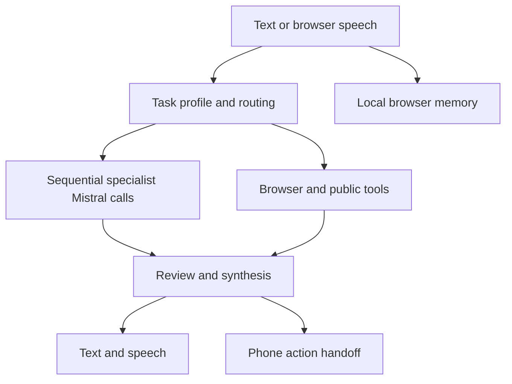

# Sage Companion — Studio Niko Design

**French voice assistant · Mistral council orchestration · Browser-native tools and phone handoff**

 

[Application GitHub Pages (disponibilité non vérifiée)](https://nikoju1977.github.io/Sage-companion/) · [Sécurité](SECURITY.md) · [English overview](#english-overview)

## Architecture réelle

| Composant dans index.html | Fonction |
| --- | --- |
| `listen` / `speak` | Reconnaissance et synthèse vocales selon navigateur |
| `runCouncil` | Sélection de rôles et appels spécialisés successifs |
| `providers` | Fournisseur Mistral et condition de confirmation de facturation |
| `runAction` | Outils et actions navigateur, dont liens téléphone |
| `persist` | Réglages et historique en stockage local |

Le conseil utilise des appels successifs au modèle configuré, avec gestion de certaines erreurs et limitations de débit. Il ne constitue pas un groupe d'experts indépendants. La page contient aussi des chemins expérimentaux de génération d'image distante et d'aperçu de code ; leur fonctionnement et leurs garanties de sécurité ne sont pas établis.

Compagnon vocal en français, single-file HTML, par **Studio Niko Design**.

- Voix dans les deux sens (reconnaissance + synthèse du navigateur), interruption en touchant l'orbe, conversation continue mains libres.
- Cerveau **Mistral uniquement** (`mistral-small-latest`), avec garde « 0 € » : aucune génération tant que le mode Gratuit n'est pas confirmé.
- Conseil multi-agent (Auto / Supra / Fulgurant), vision sur photo, outils : Wikipédia, météo Open-Meteo, position, batterie.
- Actions téléphone confirmées d'un toucher : appel, SMS, e-mail, carte, musique, minuteur, rappel `.ics`, lampe.
- Données locales (IndexedDB) : réglages, historique, notes, profil vocal acoustique indicatif.
- Installable (PWA).

## Utilisation
1. Ouvrir la page dans Chrome (Android conseillé).
2. ⚙ → coller la clé Mistral → **Valider ma clé Mistral** → cocher la confirmation mode 0 € → **Enregistrer**.
3. Toucher l'orbe et parler.

## Limites honnêtes
Une page web ne pilote pas le téléphone en arrière-plan : chaque action passe par un toucher de confirmation. L'objectif 0 € dépend du réglage du compte Mistral (mode Gratuit, paiement à l'usage désactivé). L'offre gratuite Mistral est limitée en débit : les appels sont espacés automatiquement.

Conventions : XHR pour les échanges conversationnels, fetch pour certaines autres requêtes, `sanitizeKey()`, `safeStorage` (IndexedDB + repli mémoire).

## Confidentialité, permissions et facturation

Les réglages persistés contiennent la clé Mistral et les contacts ; IndexedDB et le repli mémoire n'apportent pas de chiffrement applicatif établi. La mémoire conversationnelle peut être réutilisée dans le contexte distant. Les services vocaux, de localisation, de recherche et de vision peuvent avoir des flux réseau distincts. Ne pas utiliser de secrets ou de données personnelles réelles pour les démonstrations.

La confirmation « 0 € » est un garde d'interface pour la génération, pas une vérification du contrat, du quota ou de la facture Mistral. La validation de clé interroge le service de modèles ; elle ne certifie pas la gratuité. L'accès aux modèles et aux fonctions distantes reste à vérifier séparément.

L'ouverture d'un composeur d'appel, SMS ou e-mail n'est pas une preuve de transmission. Les permissions, l'enregistrement, les rappels, la caméra et les aperçus de code exigent une revue spécifique ; ne pas utiliser comme alarme critique ou exécuter du code inconnu.

## Qualification proposée

Servir le dépôt sur localhost et vérifier les états d'autorisation, la saisie de texte, la gestion des erreurs simulées, l'interruption vocale et les confirmations d'action sans envoyer de message ni appeler un tiers. Examiner la persistance, l'effacement et les flux réseau avec données fictives. Aucun test de microphone, modèle distant, facturation, téléphone physique ou déploiement n'a été exécuté ici.

## English overview

Sage is a French browser voice companion with sequential Mistral specialist calls, local memory, browser speech APIs, optional vision and public tools. Phone actions rely on browser capabilities and handoff rather than unrestricted operating-system control. The zero-cost confirmation is not a billing guarantee. Browser-stored settings, including the Mistral credential, lack established application-level encryption. No live provider or device test was run during this documentation revision.

## Licence et contribution

[LICENSE.md](LICENSE.md) : droits réservés pour les contributions originales concernées. Les composants et services tiers conservent leurs droits. Signaler les anomalies sans secrets ni conversations privées ; consulter [SECURITY.md](SECURITY.md).

**Studio Niko Design** · Voice interaction and explicit execution boundaries.
